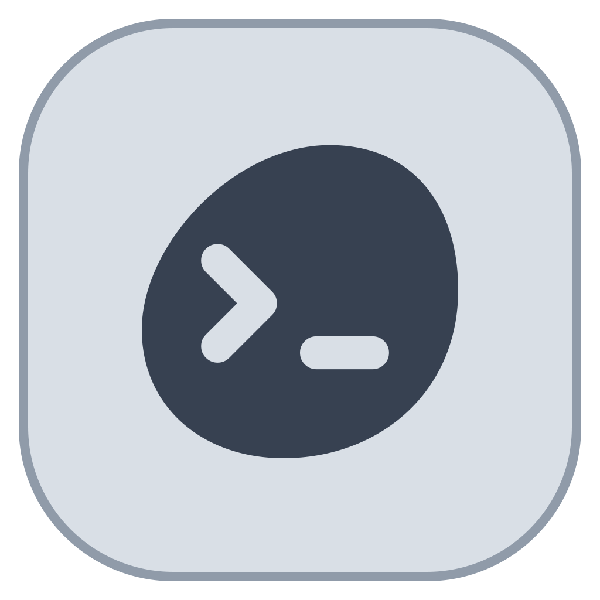
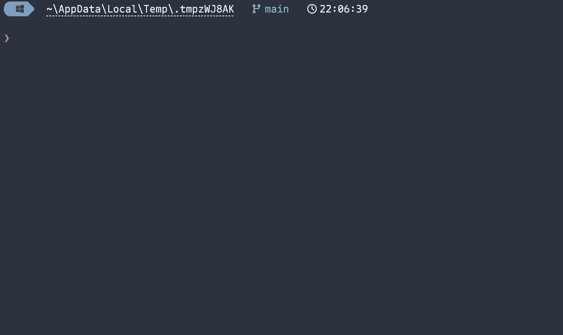
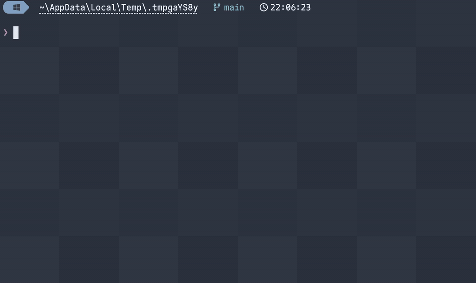

<p align="center">
  
</p>

<h1 align="center">Pebrel</h1>

<p align="center">
  <strong>GPU アクセラレーションに対応したターミナル、SSH ワークスペース、そして AI CLI セッションの拠点です。</strong>
</p>

<p align="center">
  Rust と GPUI で開発され、Windows、macOS、Linux で動作します。<br />
  分割ターミナル · SSH &amp; SFTP · Claude Code &amp; Codex のワークフロー · ネイティブのドキュメントリーダー
</p>

<p align="center">
  <a href="https://trendshift.io/repositories/127463?utm_source=trendshift-badge&amp;utm_medium=badge&amp;utm_campaign=badge-trendshift-127463" target="_blank" rel="noopener noreferrer"></a>
</p>

<p align="center">
  <a href="https://pebrel.com"></a>
  
  <a href="https://atomgit.com/kettys/pebrel"></a>
  <a href="https://hub.xerj.org/contributors/Kuddev"></a>
  
  
  <a href="https://discord.gg/VFn4rcxmhn"></a>
  <a href="https://linux.do"></a>
</p>

<p align="center">
  <a href="README.md">English</a> · <a href="README.zh-CN.md">简体中文</a> · <strong>日本語</strong>
</p>

---

<p align="center">
  
</p>

<p align="center">
  
</p>

<p align="center">
  
</p>

## 💖 スポンサー

<table>
  <tr>
    <td align="center" width="240">
      <a href="https://cn.aiapi.bot/invite?code=MCYLZ5H6FR"></a><br />
      <a href="https://cn.aiapi.bot/invite?code=MCYLZ5H6FR"><strong>AIAPI</strong></a>
    </td>
    <td>
      <p><strong>このプロジェクトをスポンサーしてくださっている AIAPI に、心より感謝します！</strong></p>
      <p>AIAPI は、Web 上で最も安定した AI モデルのリレーの構築に取り組んでおり、個人開発者、技術チーム、企業に統一された API を提供しています。性能を落とさず、制限もかけない Claude と GPT のモデルを提供しており、機能の削減も希釈も一切なく、100% 純粋なネイティブ性能を実現しています。動的なマルチルートのスケジューリングによる高可用性、レイテンシーと課金の完全な透明性、そしていつでも頼れる一流のアフターサポートに支えられ、AIAPI は公式料金と比べて API のコストを 40%〜98% 削減します。</p>
      <p><a href="https://cn.aiapi.bot/invite?code=MCYLZ5H6FR">AIAPI を見る</a></p>
    </td>
  </tr>
  <tr>
    <td align="center" width="240">
      <a href="https://sidrune.ai/register?source=github&campaign=pebrel&promo=pebrel"></a><br />
      <a href="https://sidrune.ai/register?source=github&campaign=pebrel&promo=pebrel"><strong>Sidrune AI</strong></a>
    </td>
    <td>
      <p><strong>世界をリードする AI モデルにアクセスし、管理するためのひとつの入り口</strong></p>
      <p>このプロジェクトをスポンサーしてくださっている Sidrune AI に感謝します！Sidrune AI は、個人開発者、技術チーム、企業に向けて、世界をリードする AI モデルにアクセスし、管理するための統一された API を提供しています。動的なマルチルートのスケジューリングによって可用性が高まり、モデルの性能、応答時間、コストは透明に保たれます。モデルとルートによっては、API の呼び出しコストが公式価格やベンチマーク価格より 40%〜98% 安くなります。</p>
      <p><a href="https://sidrune.ai/register?source=github&campaign=pebrel&promo=pebrel">今すぐアクセスして登録</a>すると、$3 分の API クレジットを受け取れます。</p>
    </td>
  </tr>
</table>

ビジネス上の協力やスポンサーについてのお問い合わせ先：[fickleheartedkeys@163.com](mailto:fickleheartedkeys@163.com)

<p align="center">
  <strong>Pebrel WeChat コミュニティ</strong>
</p>

<p align="center">
  <a href="extra/community/wechat-group-2026-11-11.jpg"></a>
</p>

<p align="center">
  2026 年 11 月 11 日より前に WeChat でスキャンして参加してください。画像をクリックすると原寸で表示されます。
</p>

## ひとつのワークスペース

Pebrel（旧称 Nebula）は、ローカルのシェル、リモートホスト、ファイル、AI のコマンドライン
ツールを、ネイティブのデスクトップワークスペースにまとめます。ターミナルをタブや分割で配置し、
各エージェントの動きを追いかけ、アプリケーションを離れることなくその出力を読めます。

### ターミナルとセッション

- サイドバーまたは上部のタブ、ドラッグできる分割ペイン、ペインごとの作業ディレクトリ。
- ワークスペースのレイアウトの保存と、オプションの AI 会話の復元。WSL と Linux では、
  フックが ID を報告していない場合に、Codex のセッションのメタデータから ID を補えます。
- ネイティブ Windows の Codex のアイデンティティの更新では、起動時のカーソルフィードバックを
  無効にしたバックグラウンドのヘルパーを共有します。各更新は現在のメタデータを読み取り、
  時間の上限内に収まります。停止したヘルパーは、後続の更新が代わりを作成する前に停止されます。
- Windows では、オプションのバックグラウンド常駐によって、ウィンドウを閉じても実行中の
  セッションが維持されます。プロセスの終了後に会話を復元するのは別の機能であり、
  対応している CLI と利用可能なセッションのアイデンティティが必要です。
- コンテキストに応じた補完と履歴の補完、設定可能なキーバインド、統合されたシェルプロンプト。
- 保存済みコマンドの管理では、チェックボックスで選択し、まとめて 1 回の確認で削除できるため、
  コマンドを 1 つずつ繰り返し削除する必要がありません。選択モードでコマンドが実行されることは
  なく、検索やフォルダーを変えると選択は解除されます。**Select results** は、ビューポートより
  下の行も含め、現在の絞り込み結果のコマンドを選択します。
  **Manage → Delete all commands** は、現在の検索やフォルダーに関係なく、カスタムコマンドと、
  すべてのプラットフォームの現在の組み込みレシピを消去します。フォルダーは残ります。
  組み込みの消去には、別のフォルダーに移動したレシピも含まれます。空になった組み込みの
  フォルダーは消え、**Manage → Restore built-in commands** を使うと、削除したレシピが
  既定のフォルダーに復元されます。カスタムコマンドの削除はここでは元に戻せません。
  カスタムフォルダーの削除には確認が必要で、そのコマンドは Ungrouped に残ります。
  一括変更には、既存のロック付きで最新化されたアトミックなストアのトランザクションを再利用します。
  保存ファイルの形式は変わらず、古い選択が無関係な編集を上書きすることもありません。
- ターミナルのショートカットを割り当て直したり無効にしたりしても、テキストフィールドの
  ネイティブの貼り付けキーは維持されます。既定に戻すと、再起動せずに既存のウィンドウにも
  反映されます。実行時の上書きは以前のルールを置き換えるため、追記のみの方式で生じていた
  古い無効化バインドが残ることはありません。保存される設定の形式は変わりません。
  詳しくは[ショートカットの所有に関する決定](architecture/notes/nebula_app/gpui_shell/workspace/2026-10-07-keyboard-override-sources.md)をご覧ください。
- ローカルの Windows PowerShell のプロンプトでは、複数行のクリップボードの貼り付けを
  PSReadLine 内に留めて確認できます。Enter で送信し、1 回の Undo で貼り付け全体を取り消せます。
  これには、シェル統合が有効で、管理対象の貼り付けショートカットにユーザーのバインドがないことが必要です。
  PSReadLine は CRLF を正規化し、タブを 4 つのスペースに展開します。その他のエディターは、
  ネゴシエートされた貼り付けや既存の確認動作をそのまま保ちます。詳しくは
  [クリップボードの貼り付けの契約](architecture/notes/nebula_app/gpui_shell/terminal/view/2026-10-23-powershell-clipboard-paste.md)をご覧ください。

### インテリジェントな補完

現在の Git リポジトリ、プロジェクトのスクリプト、SSH の設定、ファイルシステムから候補を
提示します。一度も実行したことのないコマンドでも補完できます。Windows では、
登録済みの WSL ディストリビューションも補完します。これらの候補は Pebrel 独自の補完エンジンから
提供されるもので、シェルの補完プラグインも AI へのリクエストも使いません。

実際の Windows/PowerShell ターミナルでの 5 つのコマンド：Git のブランチ、npm のスクリプト、
SSH のエイリアス、WSL のディストリビューション、そして `cat` での引用符付きのファイル名です。
組み込みの Powerline プロンプトを使い、1 文字ずつ入力しています。

<p align="center">
  
</p>

設定で、**Inline**（Tab で候補を確定）、**List**（Tab で選択中の候補を確定）、
**Hybrid**（→ でインラインの候補を確定し、Tab で一覧を開く）のいずれかを
選べます。

<details>
<summary>履歴の補完との違い</summary>

履歴の補完は、すでに実行したことのあるコマンドを呼び出します。ここでは、`echo dep` が
初回の実行後に `echo deployment finished` を呼び出しています。上の 5 つの例は、
以前のコマンドと照合することなく、現在の環境から候補を見つけています。

<p align="center">
  
</p>

</details>

### SSH とファイル

- ホストライブラリ、ランチャー、コマンドパレット、Quick Jump で、名前、アドレス、グループ、
  タグ、メモから SSH ホストを検索できます。スペースで区切ったキーワードはすべて一致する必要があり、
  大文字と小文字は区別されません。ランチャーもホストライブラリと同じメタデータを使うようになりました。
- 保存済みのホスト、SSH の設定のエイリアス、プロキシと踏み台ホストのオプション、秘密鍵と
  キーボードインタラクティブ認証、ホスト鍵の検証。
- SFTP の閲覧、アップロードとダウンロード、フォルダーの転送、進捗表示、キャンセル。
- ターミナルと並べて使える、ローカルファイルの閲覧と Git の操作。
- 複製した WSL や SSH のタブは、既知の作業ディレクトリを引き継ぎます。

<p align="center">
  
</p>

### AI CLI のワークフロー

- Claude Code、Codex、その他の認識された CLI には、それぞれ専用のアイコンとアクティビティの
  状態があります。対応しているフックのイベントによって、より正確な進捗と注意を促すシグナルが得られます。
- 通知は発生元のペインに紐付いており、クリックするとそのターミナルに戻ります。
- 取得した Claude Code と Codex の回答は、Markdown、数式、ソーステキスト、ローカル画像の
  プレビューに対応したリーダーで開きます。リーダーの操作や通知は選択した言語に従い、
  Copy source では元の回答全体がそのまま保たれます。詳しくは
  [リーダーの言語の動作](docs/answer-reader-language.md)をご覧ください。
- クリップボードの画像は PNG ファイルとして保存され、そのパスがローカル、WSL、SSH の
  セッションに挿入されます。ターミナル内での画像表示には、CLI が対応している
  OSC 1337 プロトコルを出力する必要があります。画像の添付のプレビューは CLI 自体に依存します。

<p align="center">
  
</p>

### ネイティブで設定可能なインターフェース

- GPU アクセラレーションに対応した GPUI のインターフェース、ライトテーマとダークテーマ、背景、不透明度の調整。
- アプリケーションのアイコンのパレットと、11 の UI 言語の選択肢。未翻訳のテキストは
  英語で表示されます。
- ワークスペースのダイアログ、コマンドのフィードバック、Git/SVN の操作、既定の通知は、
  選択した言語に従います。言語を切り替えても、コマンドの検索テキストと選択は保たれます。
  詳しくは[国際化](docs/internationalization.md)をご覧ください。
- 検索可能な設定、コマンドパレット、検証とライブリロードに対応した Lua の設定。
  既存の TOML の設定も引き続きサポートされます。
- Markdown のドキュメントタブと、WebView を使わないネイティブの数式組版。

<p align="center">
  
</p>

<p align="center">
  
</p>

## ダウンロード

**[最新のリリース](https://github.com/Kuddev/pebrel/releases/latest)** からパッケージを選んでください。

| システム | アーキテクチャ | パッケージ |
| --- | --- | --- |
| Windows 10 1809+ / 11 | x64 | インストーラー `.exe`、ポータブル版 `.zip` |
| Linux プレビュー版、glibc 2.35+ | x64 | `.AppImage`、`.deb`、ポータブル版 `.tar.gz` |
| macOS プレビュー版、デプロイメントターゲット 14+ | Apple Silicon / arm64 | `.dmg` |
| macOS プレビュー版、デプロイメントターゲット 14+ | Intel / x64 | `.dmg` |

パッケージ名は `Pebrel-v<version>-<system>-<architecture>` の形式です。Windows には、
`-setup.exe` で終わる安定版のインストーラーとポータブル版の ZIP があります。Linux と macOS は
プレビュー版のビルドで、拡張子の前に `-preview` が付きます。古い自動アップデートのクライアント向けに、
旧名称の Windows インストーラーも提供しています。

Windows では、インストーラーを実行するか、ZIP を展開して `pebrel.exe` を起動してください。
同梱のディレクトリは一緒にしておいてください。Linux では、DEB をインストールするか、AppImage に
実行権限を付けてください。macOS では、対応する DMG を開いて Pebrel をアプリケーションにドラッグしてください。
アドホック署名の macOS ビルドでは、初回起動時に **システム設定 >
プライバシーとセキュリティ** で **このまま開く** を選ぶ必要がある場合があります。macOS のネイティブ CI は
macOS 15 で実行されています。デプロイメントターゲットだけでは、それより古いすべての OS バージョンで
検証されていることにはなりません。

Pebrel 2.1 では、ネイティブのトレイの操作、クイックターミナルのショートカット、ログイン時の起動、
ローカルの AI フックのセットアップが、Windows、macOS、Linux で使えるようになりました。Linux のトレイ統合には
ステータスノーティファイアーを使い、Wayland のショートカットにはデスクトップポータルを使います。Windows と
macOS ではネイティブのアップデートのインストールに対応しています。Linux のアップグレードには、パッケージマネージャー
か新しいパッケージを使います。プラットフォームの要件と、既存の Nebula のインストールからのアップグレードについては、
[インストールの詳細](INSTALL.md)をご覧ください。

## セルフホストのリレー

スマートフォンで、パスワード認証または秘密鍵認証の SSH ホストを保存し、リレーのセットアップでその
ホストを選択します。鍵認証の場合、認証情報の欄には秘密鍵のパスフレーズを入力します。暗号化されていない
鍵の場合は空のままにしてください。これはリレーのパスワードではありません。インストール後、デスクトップの
**Settings → Phone connection → Relay** で SSH ホストを選択し、スマートフォンのペアリング用の QR コードを生成します。

サーバーの要件、検証、管理については、[オフラインのリレーのインストール](mobile/relay-native/INSTALL.md)をご覧ください。
元の v2.1.1 のリリースアセットには、オフラインのリレーのキットは含まれていませんでした。そのインストーラーを
含むソースのチェックアウトでは、`mobile/tools/package_manual_relay.py` を使って、検証済みの APK から 2 つの
アーキテクチャ向けの Linux のキットと SHA256 のサイドカーを生成できます。このツールは実行ファイルをダウンロード
したり、リリースアセットを公開したり置き換えたりはしません。
古い APK では、対応するソースから収集した Cargo の依存関係の通知も必要です。
インストールガイドにそのためのコマンドが記載されています。

## 設定

```sh
pebrel config init --language en-US
pebrel config check
```

生成される Lua の設定では、`require 'pebrel'` と `pebrel.config_builder()` を使います。
無効なリロードが行われた場合は、最後に有効だった設定が保持されます。
設定項目と例については、[Lua の設定ガイド](docs/lua-configuration.md)をご覧ください。

**Settings → Terminal → Alerts** の **Notification duration** では、**Use defaults**、
5、10、30、90 秒、または **Until dismissed** を選べます。既定値では従来の表示時間が保たれます：
短いトーストは 5 秒、メッセージバナーは 90 秒表示され、アップデートの通知は閉じるまで
表示されたままです。保存された設定は、AI トーストの表示スイッチとは独立して、新たに表示または
更新されるすべてのアプリ内カードに適用されます。
保持されるのは最新の 3 枚のカードだけで、新しいカードは古いカードの操作を実行することなく置き換えます。
これは表示し続けるモードでも同じです。
カードを非表示にしても、リクエストが承認や拒否されたり、タスクの状態が変わったりすることはありません。
リクエストはそれぞれのターミナルで、アップデートは設定で引き続き利用できます。システムの通知は
変わりません。保存されるキーは `notification_duration` で、値は `default`、
`5`、`10`、`30`、`90`、`persistent` のいずれかです。
[通知の表示時間のメニュー](docs/screenshots/notification-duration.png)をご覧ください。

## ビルド

固定された Rust ツールチェーンとプラットフォームの依存関係をインストールした状態で、次を実行します：

```sh
cargo build --release --locked -p nebula --bin pebrel --features gpui-shell
```

内部の Cargo パッケージの名前は今も `nebula` ですが、アプリケーションとコマンドの名前は
`pebrel` です。製品のインターフェースは GPUI です。旧来のレンダラーは、明示的な
`legacy-shell` フィーチャーを通じてのみ利用できます。

## 連絡先

Discord: [discord.gg/VFn4rcxmhn](https://discord.gg/VFn4rcxmhn)

## 謝辞

Pebrel には、サードパーティのターミナル、インターフェース、フォントのコンポーネントが含まれています。
それらの出所、著作権、ライセンスの表示は、
[THIRD-PARTY-NOTICES](THIRD-PARTY-NOTICES) と [licenses/](licenses/) に保存されています。

<p>Pebrel の開発に追加のサポートを提供してくださっている <a href="https://molchuan.com/"><picture>
  <source media="(prefers-color-scheme: dark)" srcset="extra/logo/acknowledgement_1molchuan_dark.png">
  
</picture></a> に感謝します。</p>

## コミュニティ

- **[linux.do](https://linux.do)** - 活気ある開発者コミュニティです。

## ⭐ スターの推移

<a href="https://star-history.com/#Kuddev/pebrel&Date">
  <picture>
    <source media="(prefers-color-scheme: dark)" srcset="https://api.star-history.com/svg?repos=Kuddev/pebrel&type=Date&theme=dark" />
    <source media="(prefers-color-scheme: light)" srcset="https://api.star-history.com/svg?repos=Kuddev/pebrel&type=Date" />
    
  </picture>
</a>
